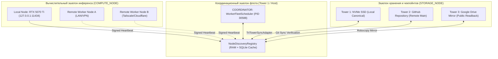

# Stage R27 — Архитектурная спецификация распределённого шлюза Discovery-узлов (Distributed Node Discovery Gateway)

**Стандарт:** BPR5 NextGen (v5.1.0-alpha / R3.3) / Senior Architecture Standard v6.0  
**Стадия:** Stage R27 / RAiF R0.7  
**Авторизация:** MTD 011011  
**Статус:** CANONICAL DRAFT  

---

## 1. Цели и назначение (🎯 what_for + proof)

Stage R27 развивает возможности распределённого пула воркеров (`DistributedWorkerPool`, Stage R0.6) до уровня динамической сетевой топологии флота. Спецификация определяет:
1. **Децентрализованный реестр узлов (`NodeDiscoveryRegistry`):** автоматическая регистрация локальных рабочих станций, серверов и GPU-инференс демонов с динамическим отслеживанием их доступности.
2. **Типологию ролей узлов:**
   - `COMPUTE_NODE` — аппаратные ускорители инференса (NVIDIA RTX 5070 Ti, локальные демоны `:11434`, удалённые GPU-ноды);
   - `STORAGE_NODE` — контрольные узлы Трёх Башен (SSD, GitHub, Google Drive зеркала);
   - `COORDINATOR_NODE` — диспетчеры очередей и супервизоры процессов (`WorkerFleetScheduler`, `UnifiedSupervisor`).
3. **Lease-based Heartbeat:** подтверждение жизнеспособности узлов каждые $T_{hb} \le 15$ секунд с автоматическим переводом в `DEGRADED` при пропуске 2 пульсов и вытеснением (`EVICTED`) через 60 секунд.
4. **Zero-Trust криптографический конверт:** каждый пакет регистрации и пульса подписывается по протоколу `TransportMessageEnvelope`.

---

## 2. Архитектурная диаграмма сетевой топологии



---

## 3. Модель данных и контракт узла

```json
{
  "node_id": "node-gpu-rtx5070ti-01",
  "role": "COMPUTE_NODE",
  "endpoint": "http://127.0.0.1:11434",
  "capabilities": ["inference", "code-eval", "streaming"],
  "resources": {
    "gpu_model": "NVIDIA GeForce RTX 5070 Ti",
    "vram_total_mb": 16303,
    "vram_used_mb": 1254,
    "temperature_c": 50
  },
  "lease_ttl_seconds": 30.0,
  "registered_at": 1791999200.0,
  "last_heartbeat": 1791999280.0,
  "status": "ONLINE"
}
```

---

## 4. Инварианты безопасности флота (Safe Sync Gate)

1. **FAIL_CLOSED:** При отсутствии связи с узлом инференса координатор мгновенно исключает его из активного маршрута и переводит поток на локальный резерв.
2. **ZERO_SSD_WEAR:** Динамические пульсы (`heartbeat`) регистрируются исключительно в оперативной памяти координатора (`RAM registry`). На диск сбрасываются только опечатанные квитанции изменения топологии.
3. **CANONICAL_CONSISTENCY:** Все зарегистрированные узлы обязаны согласовывать версию BPR5-протокола (`v5.1.0-alpha / R3.3`).
