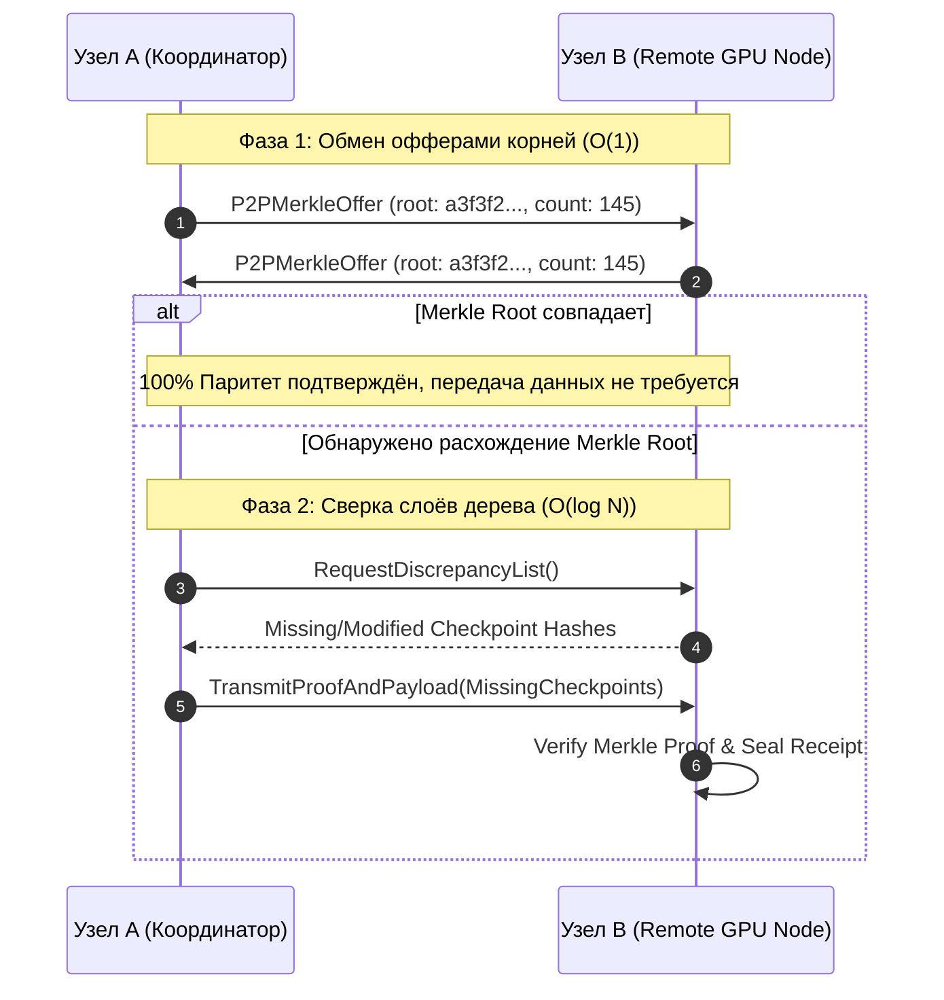

# Stage R28 — Архитектурная спецификация P2P Merkle-обмена квитанциями флота (Peer-to-Peer Merkle Exchange Protocol)

**Стандарт:** BPR5 NextGen (v5.1.0-alpha / R3.3) / Senior Architecture Standard v6.0  
**Стадия:** Stage R28 / RAiF R0.8  
**Авторизация:** MTD 011011  
**Статус:** CANONICAL DRAFT  

---

## 1. Цели и назначение (🎯 what_for + proof)

Stage R28 расширяет архитектуру Трёх Башен (SSD, GitHub, Google Drive) до одноранговой (Peer-to-Peer) модели синхронизации контрольных точек.
В условиях сетевой изоляции, разделения каналов (split-brain) или работы удалённых узлов инференса без прямого доступа к GitHub, узлы флота обмениваются Merkle-дайджестами и доказательствами (Merkle Proofs) напрямую:
1. **Децентрализованное согласование (Anti-Entropy Sync):** сравнение корней Merkle-дерева $O(1)$ и выявление расходящихся чекпойнтов за $O(\log N)$ шагов без передачи всего тела каталога `checkpoints/`.
2. **Zero-Trust Proofs:** математическое доказательство включения файла контрольной точки в опечатанный блок без раскрытия сырых секретов.
3. **Криптографическая неизменяемость:** полная совместимость с `TriTowerSyncAdapter` и инвариантом `PRIVACY > SECURITY > DATA_INTEGRITY`.

---

## 2. Архитектурная диаграмма P2P протокола



---

## 3. Контракт P2P Merkle Proof

```json
{
  "protocol": "BPR5_NEXTGEN_R3.3",
  "stage": "STAGE_R28_P2P_MERKLE",
  "checkpoint_name": "001_genesis.json",
  "file_hash": "e3b0c44298fc1c149afbf4c8996fb92427ae41e4649b934ca495991b7852b855",
  "merkle_root": "a3f3f20596f2f81b45cad6547c660b5123403c1927a647fa2828653939ade39f",
  "proof_path": [
    {"direction": "right", "sibling_hash": "8f434346648f6b96df89dda901c5176b10a6d83961dd3c1ac88b59b2dc327aa4"}
  ],
  "verification_status": "VERIFIED_PASS"
}
```

---

## 4. Инварианты безопасности флота (Safe Sync Gate)

1. **NO_SECRET_LEAKAGE:** В открытом P2P канале циркулируют исключительно SHA-256 хеши и метаданные чекпойнтов.
2. **ZERO_SSD_WEAR:** Хеширование и обход Merkle-дерева производятся в памяти (in-memory AST & dicts).
3. **FAIL_CLOSED:** При несовпадении подписи хотя бы одного доказательства узел отвергает весь пакет синхронизации.
