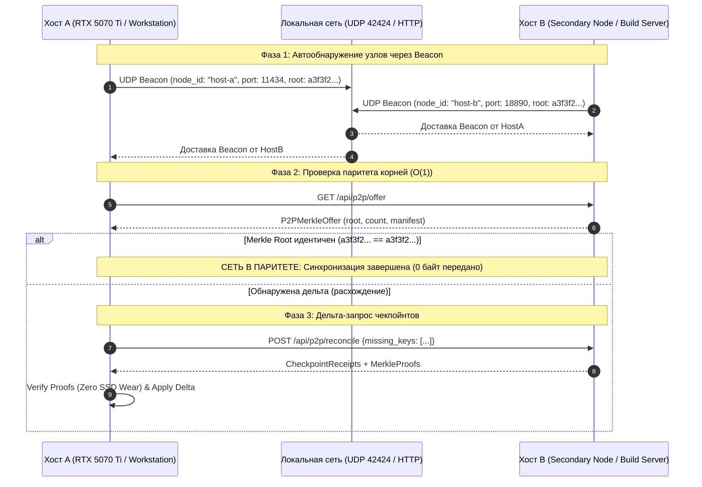

# Stage R29 — Архитектурная спецификация кросс-хостовой P2P-синхронизации флота (Cross-Host LAN/mDNS P2P Merkle Protocol)

**Стандарт:** BPR5 NextGen (v5.1.0-alpha / R3.3) / Senior Architecture Standard v6.0  
**Стадия:** Stage R29 / RAiF R0.9  
**Авторизация:** MTD Authorized  
**Статус:** CANONICAL DRAFT  

---

## 1. Цели и назначение (🎯 what_for + proof)

Stage R29 расширяет одноузловой и трёхбашенный паритет (SSD, GitHub, Google Drive) до распределённого объединения независимых физических рабочих станций флота «Рассвет» через локальную сеть (LAN / mDNS / Subnet).

В условиях разделения каналов связи, работы в автономных локальных контурах или при наличии нескольких вычислительных узлов (например, рабочей станции с RTX 5070 Ti и вспомогательных серверов сборки), протокол Stage R29 обеспечивает:
1. **Автономное обнаружение узлов (Zero-Config LAN Discovery):** узлы оповещают о себе широковещательными маяками (UDP Broadcast / Beacon на порту 42424) с информацией о своём `node_id`, HTTP-эндпоинте, текущем `merkle_root` и числе чекпойнтов.
2. **Антиэнтропийная сверка состояний (Anti-Entropy Exchange):** сравнение корней Merkle-дерева $O(1)$ между хостами локальной сети. Если корни совпадают — сеть находится в 100% паритете.
3. **Дельта-репликация чекпойнтов (Delta Sync):** при расхождении корней узел запрашивает исключительно отсутствующие или изменившиеся контрольные точки за $O(\log N)$ шагов с верификацией Merkle Proofs.
4. **Zero SSD Wear & Fail-Closed:** все сетевые пакеты валидируются и сверяются в оперативной памяти до опечатывания. При нарушении криптографического пути или подписи конверт отбрасывается.

---

## 2. Архитектурная диаграмма Stage R29



---

## 3. Формат пакета LAN Beacon

```json
{
  "protocol": "BPR5_NEXTGEN_R3.3",
  "stage": "STAGE_R29_LAN_P2P",
  "node_id": "host-alpha-5070ti",
  "host": "192.168.1.105",
  "port": 11434,
  "merkle_root": "a3f3f20596f2f81b45cad6547c660b5123403c1927a647fa2828653939ade39f",
  "checkpoints_count": 145,
  "capabilities": ["inference", "merkle-sync", "multi-model"],
  "timestamp": 1728950400.0,
  "ttl_seconds": 30.0
}
```

---

## 4. Инварианты безопасности (BPR5 Safe Sync Gate)

1. **NO_RAW_PAYLOAD_LEAKS:** Передаются только хеши контрольных точек и метаданные квитанций.
2. **BOUNDED_TTL:** Записи узлов в реестре пиров устаревают через 30 секунд при отсутствии подтверждающих маяков.
3. **ISOLATION_FALLBACK:** При отсутствии сетевого стека или блокировке UDP-широковещания система штатно работает в режиме Loopback / Isolated Node с нулевыми накладными расходами.
