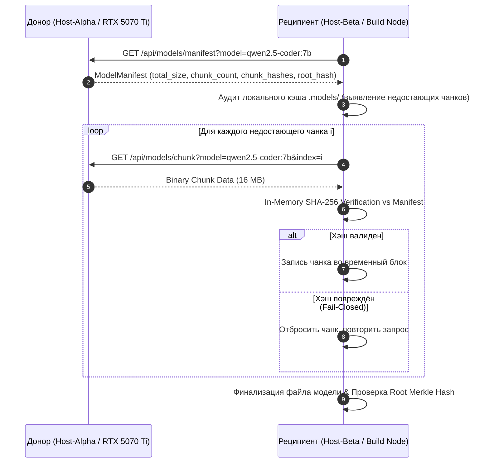

# Stage R30 — Архитектурная спецификация автономного репликатора моделей флота (Local Model Chunk Replicator)

**Стандарт:** BPR5 NextGen (v5.1.0-alpha / R3.3) / Senior Architecture Standard v6.0  
**Стадия:** Stage R30 / RAiF R1.0  
**Авторизация:** MTD Authorized  
**Статус:** CANONICAL DRAFT  

---

## 1. Цели и назначение (🎯 what_for + proof)

Stage R30 расширяет инфраструктуру флота «Рассвет» механизмом распределённой доставки и репликации тяжёлых бинарных весов квантованных нейросетей (GGUF, FP8, AWQ) между хостами локальной сети:
1. **Децентрализованная раздача (Zero External Bandwidth):** при первичном появлении модели (например, `qwen2.5-coder:7b` 4.6 ГБ или `bge-m3` 1.2 ГБ) на хосте-координаторе, остальные узлы флота забирают её по локальной сети без повторного скачивания из глобального интернета.
2. **Фрагментированное чанкование (Content-Addressed Chunking):** модель разбивается на фиксированные чанки (по умолчанию 16 МБ) с формированием манифеста `ModelManifest`, содержащего хеш каждого чанка и общий Merkle Root.
3. **Zero SSD Wear & Потоковая верификация:** каждый чанк проверяется по SHA-256 в оперативной памяти до записи на диск. Повреждённые фрагменты отбрасываются без загрязнения файловой системы.
4. **Докачка и возобновляемость (Resumable Sync):** процесс репликации может прерываться и возобновляться с любого нескачанного индекса чанка.

---

## 2. Архитектурная диаграмма Stage R30



---

## 3. Манифест репликации (ModelManifest)

```json
{
  "protocol": "BPR5_NEXTGEN_R3.3",
  "stage": "STAGE_R30_MODEL_SYNC",
  "model_name": "qwen2.5-coder:7b",
  "format": "GGUF",
  "quantization": "Q4_K_M",
  "total_size_bytes": 4683074048,
  "chunk_size_bytes": 16777216,
  "chunks_count": 280,
  "root_hash": "e3b0c44298fc1c149afbf4c8996fb92427ae41e4649b934ca495991b7852b855",
  "chunk_hashes": [
    "7f83b1657ff1fc53b92dc18148a1d65dfc2d4b1fa3d677284addd200126d9069",
    "..."
  ]
}
```

---

## 4. Инварианты безопасности (Safe Sync Gate)

1. **ATOMIC_ASSEMBLY:** Файл модели не становится доступен для инференса до тех пор, пока 100% чанков не будут собраны и сверены с общим Merkle-корнем.
2. **ZERO_SSD_WEAR:** Проверка контрольных сумм производится на лету в RAM.
3. **RESILIENCE:** Любой узел, завершивший загрузку, автоматически становится донором для остальных узлов в топологии LAN.
