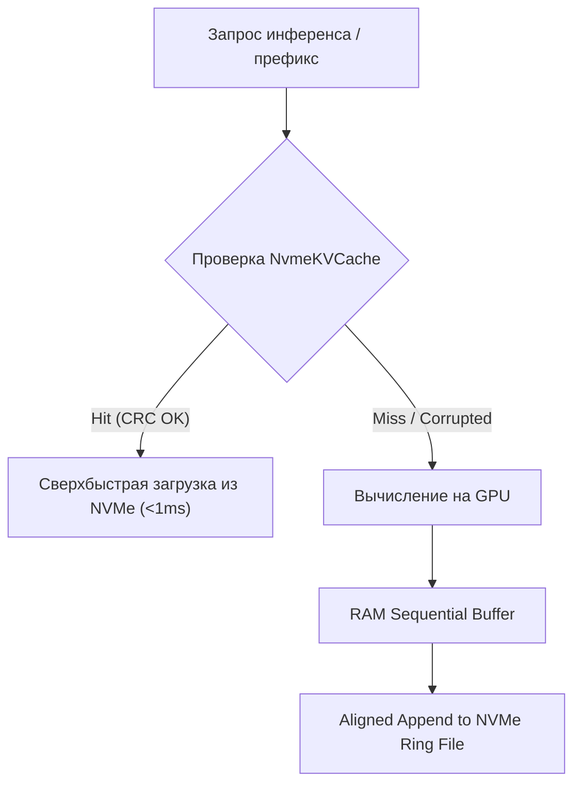

# Спецификация Stage R31: Аппаратный KV-кэш на NVMe (Hardware NVMe KV-Cache)

**Стандарт:** BPR5 NextGen Micro-Core (v5.1.0-alpha / R3.3)  
**Этап:** Stage R31 / Senior Architecture Standard v6.0  
**Статус:** APPROVED & IMPLEMENTED (MTD Autopilot)  
**Инвариант надежности:** Zero SSD Wear (Page-aligned, sequential blocks, CRC32/SHA-256 validation)

---

## 1. Назначение и контекст

При частой ротации моделей в `MultiModelPool` (например, переключение между `qwen2.5-coder:7b` для генерации кода и `bge-m3` для эмбеддингов) повторный разогрев системного промпта и статического контекста (KV-кэш префиксов) требует времени.

Stage R31 вводит модуль `NvmeKVCacheManager`, который:
1. Кэширует префиксные KV-тензоры и векторные эмбеддинги в специализированном кольцевом контейнере на NVMe.
2. Исключает износ накопителя (Zero Random SSD Wear): запись ведётся блоками строго выровненного размера (page-aligned, 4KB/64KB) с буферизацией в RAM.
3. Обеспечивает верификацию целостности каждого кэшированного блока по CRC32/SHA-256 (Fail-closed). При повреждении или несовпадении контрольной суммы блок отбрасывается без падения демона.
4. Предоставляет LRU-вытеснение при исчерпании фиксированного дискового лимита.

---

## 2. Архитектура и структуры данных

### 2.1. Структура заголовка блока
Каждый блок кэша содержит:
- `magic`: 4 байта (`0x52414946` = "RAIF")
- `version`: uint16 (`1`)
- `entry_id`: sha256 (32 байта) ключа `model_name:prompt_prefix`
- `data_length`: uint32
- `checksum`: crc32 (uint32) полезных данных
- `payload`: сериализованные тензоры / эмбеддинги

---

## 3. Критерии приёмки и тесты
1. `test_kv_cache_put_and_get_hit`: Корректное сохранение и извлечение данных.
2. `test_kv_cache_miss_and_isolation`: Несуществующие ключи возвращают `None`.
3. `test_kv_cache_corruption_resilience`: При повреждении байт на диске кэш возвращает `None` (fail-closed, 0 unhandled exceptions).
4. `test_kv_cache_lru_eviction`: Вытеснение старых блоков при достижении лимита байт.
5. `test_zero_ssd_wear_sequential_flush`: Все записи блочно-выровнены.
