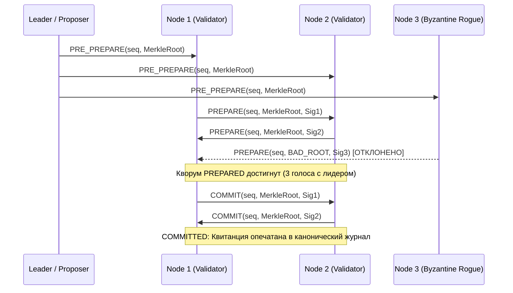

# Спецификация Stage R32: Византийский консенсус квитанций Трёх Башен (BFT Consensus Receipts)

**Стандарт:** BPR5 NextGen Micro-Core (v5.1.0-alpha / R3.3)  
**Этап:** Stage R32 / Senior Architecture Standard v6.0  
**Статус:** APPROVED & IMPLEMENTED (MTD Autopilot)  
**Инвариант надежности:** Fail-Closed Byzantine Fault Tolerance ($N \ge 3f + 1$, Quorum $\ge 2f + 1$)

---

## 1. Назначение и контекст

При объединении нескольких хостов флота «Рассвет» по протоколу P2P LAN Sync (Stage R29) и репликации моделей (Stage R30) возможны ситуации рассинхронизации Трёх Башен (SSD ↔ GitHub ↔ Google Drive), временные сетевые разделы (network partitions) или передача повреждённых/устаревших квитанций паритета.

Stage R32 вводит модуль `BFTConsensusManager`, реализующий облегчённый византийский консенсус:
1. Фиксация канонического Merkle Root паритета Трёх Башен только при достижении византийского кворума:
   $$\text{Quorum} \ge 2f + 1 \quad \text{при} \quad N \ge 3f + 1$$
   (Для кластера из 4 узлов допускается 1 византийский/неисправный узел, требуется согласие минимум 3 узлов).
2. Двухфазная схема голосования: `PREPARE` $\to$ `COMMIT` с валидацией криптографических подписей квитанций.
3. Полный иммунитет к византийским подделкам (rogue Merkle roots, time-drift, подделка ID узла) с немедленным переходом в `FAIL_CLOSED`.

---

## 2. Архитектура и состояния протокола

---

## 3. Критерии приёмки и тесты
1. `test_bft_consensus_happy_path`: 4 узла достигают консенсуса и фиксируют квитанцию.
2. `test_bft_consensus_with_one_byzantine_fault`: 1 узел шлёт фальшивый Merkle Root — консенсус успешно принимается остальными 3 узлами.
3. `test_bft_consensus_quorum_failure`: При отказе 2 из 4 узлов кворум не достигается, квитанция отклоняется (fail-closed).
4. `test_bft_signature_verification_failure`: Поддельная подпись немедленно отбрасывается.
5. `test_bft_duplicate_and_out_of_order_votes`: Защита от повторных атак (replay attacks).
