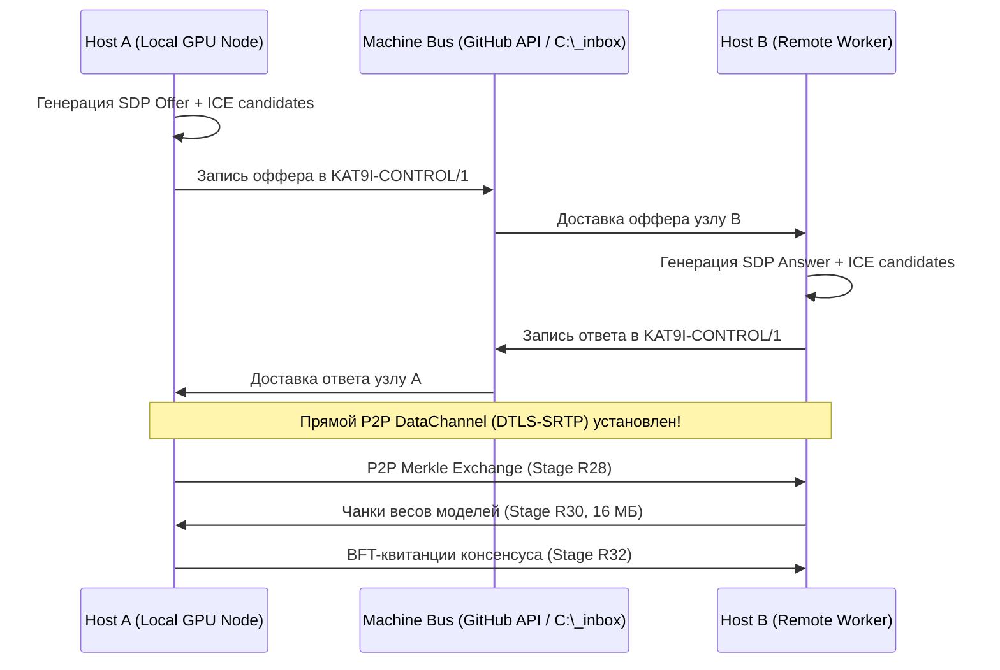

# Спецификация Stage R33: Глобальный P2P WebRTC-мост федерации флота (WAN P2P WebRTC Bridge)

**Стандарт:** BPR5 NextGen Micro-Core (v5.1.0-alpha / R3.3)  
**Этап:** Stage R33 / Senior Architecture Standard v6.0  
**Статус:** CANDIDATE SPECIFICATION (Готово к реализации в следующем спринте)  
**Инвариант надежности:** Zero-Relay E2E Encrypted P2P (DTLS-SRTP / DataChannels, STUN/TURN Failover, Fail-Closed)

---

## 1. Назначение и предпосылки

В Stages R28–R30 был реализован одноранговый обмен Merkle-квитанциями и репликация весов моделей в пределах локальной вычислительной сети (LAN / mDNS / UDP-Beacon).
Однако узлы флота «Рассвет» могут находиться в разных географических локациях за NAT/Firewall (домашний ПК с RTX 5070 Ti, удалённый сервер, мобильный хост).

Stage R33 вводит модуль `WebRtcFederationBridge`:
1. **Транспорт данных без публичных серверов:** Использование WebRTC DataChannels (SCTP поверх DTLS) для прямой передачи Merkle-квитанций, весов моделей и очередей задач.
2. **NAT Traversal:** Автоматический обход NAT через публичные STUN-серверы (STUN RFC 5389) и безопасные fallback-реле (TURN).
3. **Сигналинг через Machine Bus:** Обмен SDP-офферами/ответами (SDP Offer/Answer) и ICE-кандидатами через доверенный буфер `C:\_inbox` и GitHub API Comments (конверт `KAT9I-CONTROL/1`).
4. **Сквозное шифрование:** Встроенный DTLS 1.3 с взаимной аутентификацией открытых ключей узлов флота.

---

## 2. Архитектура и последовательность соединения

---

## 3. Требования к реализации и тестам

1. **Модуль `src/rai_fabric/webrtc_bridge.py`:**
   - Поддержка `aiortc` или нативного headless WebRTC-клиента.
   - Абстракция `IWebRtcChannel` совместимая с `RealTransportAdapter` (Stage R25).
2. **Паспорт `src/rai_fabric/webrtc_bridge.passport.json`:**
   - Стандарт `BPR40_SIDECAR_PASSPORT/1.1`.
3. **Сьют тестов `tests/test_webrtc_bridge.py`:**
   - Офлайн-мокирование ICE/SDP обмена (Zero Network Access во время CI).
   - Тестирование буферизации данных и восстановления при обрыве соединения.
   - Валидация криптографических отпечатков сертификатов DTLS.
